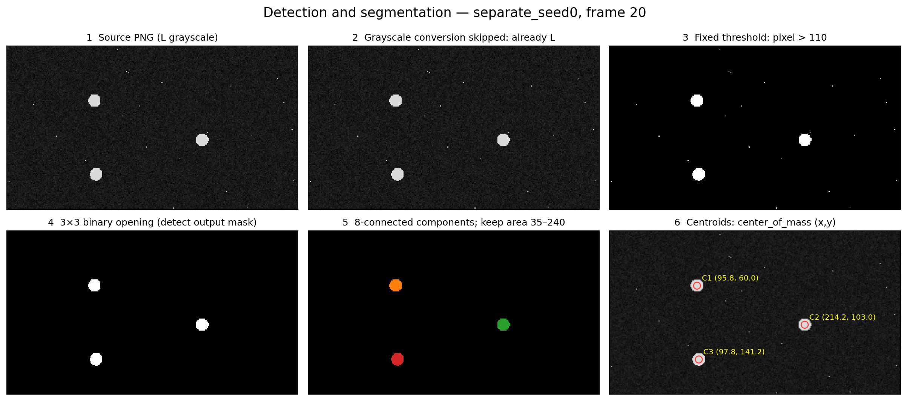
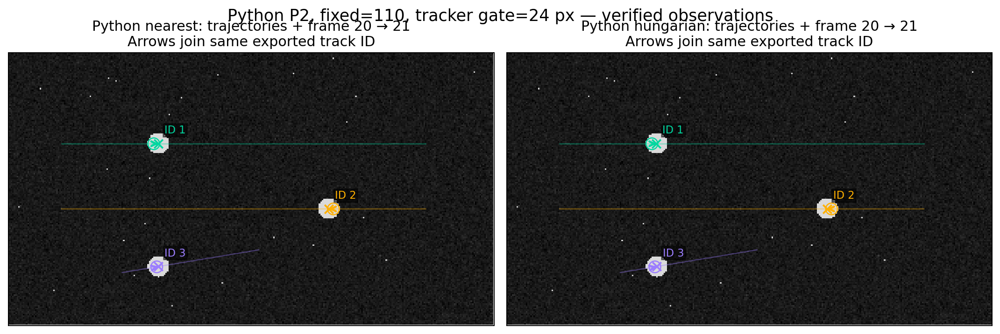
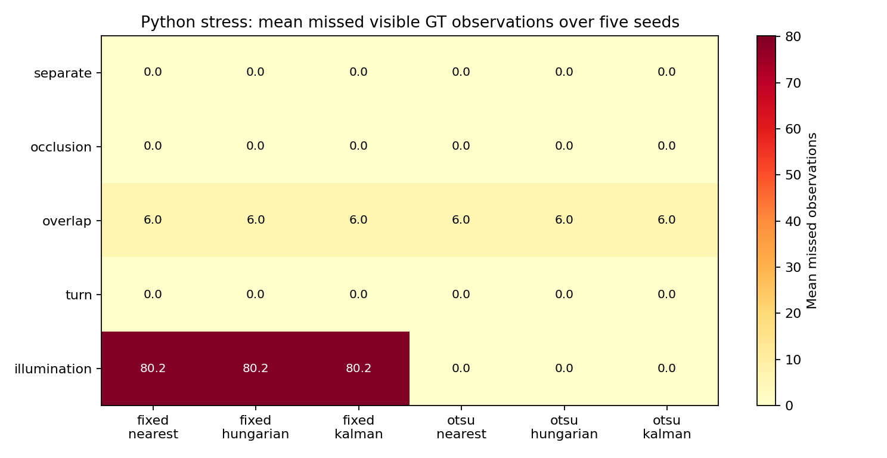
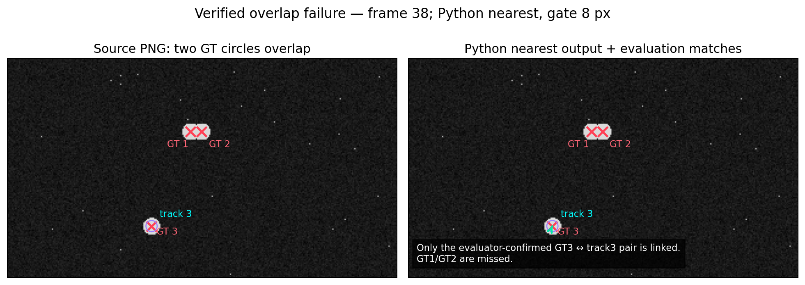

# Phát hiện và theo dõi đối tượng chuyển động trong video

**Bài tập lớn Xử lý ảnh — Nhóm 9 — PTIT**

| Thành viên | MSSV |
|---|---|
| Nguyễn Tiến Đạt | B23DCCN139 |
| Nguyễn Văn Phúc | B23DCCN957 |
| Nguyễn Hữu Anh Tài | B23DCCN730 |
| Đinh Hải Triều | B23DCCN843 |

Lớp học phần: **nhóm bổ sung**. Giảng viên: **nhóm bổ sung**. Ngày nộp: **nhóm bổ sung**. Phân công và đóng góp thực tế: **nhóm xác nhận, không suy ra từ tài khoản commit**.

## Tóm tắt

Nhóm xây dựng pipeline phát hiện vùng sáng, phân đoạn, xác định centroid, ghép đối tượng giữa các frame và tạo quỹ đạo. Ba phương pháp ghép được khảo sát là Nearest Neighbor tham lam, Hungarian và Hungarian kết hợp Kalman vận tốc hằng. Fiji/ImageJ với plugin TrackMate được dùng làm nền tảng tham chiếu; Python dùng để cài đặt, kiểm tra và khảo sát tham số.

Bằng chứng được lưu gồm 150 cấu hình stress Python, 15 đối chiếu Fiji/Python trên seed0 và 30 lượt đo runtime. Dữ liệu tổng hợp có ground truth; video thật chỉ có thống kê đầu ra và tốc độ, chưa có nhãn tay. Kết quả cho thấy ngưỡng cố định nhạy với ánh sáng, vùng gộp làm mất phát hiện, và mô hình vận tốc giúp dự đoán khi mất quan sát ngắn. Không phương pháp nào được chứng minh tốt nhất cho mọi video.

## 1. Bài toán và phạm vi

Đầu vào là chuỗi ảnh mức xám/video, vật sáng trên nền tối, tốc độ khung hình cố định. Đầu ra gồm centroid, ID, quỹ đạo và bảng CSV. Phương pháp phân ngưỡng phát hiện **vùng sáng**, không trực tiếp phân biệt vật đứng yên với vật chuyển động: vật sáng đứng yên vẫn có thể được phát hiện. “Theo dõi chuyển động” được thực hiện bằng nối các vị trí theo thời gian. Camera chuyển động, nền phức tạp và vật dính nhau nằm ngoài giả thiết tốt của baseline.

Các nội dung tương ứng đề bài:

| Yêu cầu | Cài đặt và bằng chứng |
|---|---|
| Phát hiện, phân đoạn | Threshold/Otsu, Gaussian tùy chọn, opening và connected components |
| Xác định centroid | Tâm hình học vùng nhị phân được lọc diện tích |
| Ghép giữa frame | Nearest tham lam và Hungarian có gate |
| Xây dựng quỹ đạo | ID, observations CSV, overlay; ngắt nét khi mất quan sát |
| Kalman mở rộng | Trạng thái vị trí/vận tốc, predict/update và covariance |
| Fiji làm tham chiếu | TrackMate CSV/XML, ảnh GUI và bảng F4 |
| Python benchmark/tối ưu | Solver SciPy, cache detections, giới hạn lịch sử, ghi theo luồng |

## 2. Cơ sở lý thuyết và liên hệ cài đặt

### 2.1 Phân đoạn và centroid

Với ảnh I, mask ngưỡng là B(x,y)=1 nếu I(x,y)>T, ngược lại bằng 0. Ngưỡng cố định baseline T=110; Otsu chọn ngưỡng tối đa hóa phương sai giữa hai lớp histogram. Khi dùng Gaussian với Otsu, code sau sửa làm mượt, làm tròn về uint8, rồi tính và áp dụng Otsu trên cùng ảnh đã xử lý.

Opening là erosion rồi dilation với phần tử cấu trúc 3×3. Thao tác này loại đốm nhỏ nhưng có thể làm mất vùng thủng lỗ do nhiễu. Gán nhãn liên thông mặc định 8 hướng; giữ vùng diện tích 35–240 pixel trong stress. Với vùng S có A pixel, centroid là cx=(Σx)/A, cy=(Σy)/A. Đây là tâm hình học mask, không phải tâm trọng số cường độ.

*Hình 1. Ảnh tổng hợp, ngưỡng, opening, thành phần liên thông và centroid; hình bằng chứng đã lưu trong gói thực nghiệm.*

### 2.2 Ghép đối tượng

Ma trận chi phí là khoảng cách Euclidean giữa vị trí track và detection. Gate=24 px trong stress. Nearest của Python sắp xếp các cặp theo khoảng cách rồi chọn nếu cả hai đầu chưa được dùng. Hungarian giải toàn cục với hàng/cột giả cho trường hợp không ghép, ưu tiên số cặp hợp lệ rồi tối thiểu tổng khoảng cách. **Cả hai đều ghép một-một**; khác biệt chính là quyết định tham lam so với tối ưu toàn cục.

Hungarian giải đúng mục tiêu chi phí, không bảo đảm đúng danh tính vật thật. Trong cảnh dense của bộ gốc, Hungarian giữ ID tốt hơn Nearest, nhưng vùng gộp, detector sai hoặc chuyển động mơ hồ vẫn gây lỗi.

*Hình 2. Minh họa quan sát và ID, dẫn từ các đầu ra đã lưu.*

### 2.3 Kalman và vòng đời track

Trạng thái x=[px,py,vx,vy]ᵀ; mô hình vận tốc hằng với Δt=1 frame:

- Dự đoán: x⁻=Fx, P⁻=FPFᵀ+Q.
- Đo z=[cx,cy]ᵀ; H lấy hai thành phần vị trí.
- Gain: K=P⁻Hᵀ(HP⁻Hᵀ+R)⁻¹.
- Cập nhật: x=x⁻+K(z−Hx⁻).
- Covariance dùng dạng Joseph để tăng ổn định số.

Cài đặt dùng solve thay nghịch đảo tường minh. Q=0,10GGᵀ, G=[0,5I;I], R=I, P0=diag(4,4,100,100). Đây là tham số baseline, chưa được tối ưu trên video thật.

Khi không có detection, Kalman chỉ predict. Track bị loại khi misses>5. CSV observations chỉ lưu detection được gán ID; states CSV lưu cả dự đoán với observed=0. Không trộn states vào detections khi chấm FP/FN. Lịch sử vẽ tối đa 30 điểm và ngắt đoạn qua khoảng mất quan sát.

Công thức đầy đủ, mô tả thuật toán và đối chiếu sách nằm trong [phụ lục lý thuyết](LY_THUYET.md).

## 3. Fiji/ImageJ làm tham chiếu

Nhóm dùng TrackMate với Thresholding detector và các tracker Nearest Neighbor, Simple LAP, Kalman. Stress seed0 dùng ImageJ 1.54p, TrackMate 8.1.6 và Java 21.0.7 theo metadata đã lưu. Bộ gốc có kết quả từ TrackMate 7.14.0/8.1.6, chi tiết trong README.

Quy trình: import Image Sequence → hyperstack C=1/Z=1/T đúng số frame → hiệu chuẩn pixel và thời gian → detector ngưỡng 110 → lọc diện tích/quality theo cấu hình XML → tracker → xuất CSV/XML và ảnh overlay. Stress dùng link 24 px; Simple LAP gap distance 36 px và max frame gap 6. Không suy ra tham số gap Fiji hoàn toàn tương đương Python chỉ vì tên gần giống.

Python có opening; detector Fiji không cùng pipeline. Simple LAP có nối đoạn và khác chi phí so với Hungarian online. Vì vậy so sánh hiện tại là so sánh pipeline và kiểm chứng hành vi, chưa cô lập riêng thuật toán tracker. Các phiên chạy đã lưu tại [Fiji stress](../output/person1/fiji_stress); ảnh GUI bộ gốc tại [screenshots](../results/fiji/screenshots).

## 4. Thiết kế thực nghiệm

Stress gồm separate, occlusion, overlap, turn, illumination; mỗi cảnh 80 frame, 320×180, ba đĩa bán kính 7. Seed 0–4 chỉ thay nhiễu, không thay quỹ đạo. Python chạy 5×5×2 detector×3 tracker=150 cấu hình; Fiji chạy 5 cảnh×3 tracker trên seed0=15. So sánh F4 dùng Python fixed seed0, không trộn với Otsu hoặc trung bình 5 seed.

GT có frame, object_id, x, y, visible. Occlusion có 236 observations thấy được; các cảnh còn lại có 240. Gate chấm=8 px. Tham số không được chọn riêng để làm đẹp từng kết quả test.

Metric theo [centroid-distance-framewise-v1](METRICS.md): matched/FN/FP, IDSW qua các lần ghép, RMSE chỉ trên cặp khớp, **MOTA nội bộ** và **IDF1 theo centroid**. MOTA nội bộ không tương đương CLEAR chuẩn vì không ưu tiên cặp frame trước. Mẫu số không xác định để trống, không điền 0.

## 5. Kết quả và phân tích

### 5.1 Stress Python qua năm seed

| Cảnh, ngưỡng fixed | Mean matched | Mean FN | Mean FP | Mean IDSW |
|---|---:|---:|---:|---:|
| separate, mỗi tracker | 240,00 | 0,00 | 0,00 | 0,00 |
| occlusion, mỗi tracker | 236,00 | 0,00 | 0,00 | 0,00 |
| overlap, mỗi tracker | 234,00 | 6,00 | 0,00 | 2,00 |
| turn, mỗi tracker | 240,00 | 0,00 | 0,00 | 0,00 |
| illumination, mỗi tracker | 159,80 | 80,20 | 344,00 | 0,20 |

Nguồn: [per_run.csv](../output/person1/stress_full/per_run.csv), [aggregate.csv](../output/person1/stress_full/aggregate.csv). Mean là trung bình số đếm mỗi chuỗi, không phải số vật phân số. Ở illumination, Otsu nearest có mean FN=0 và FP=0 trên bộ này. Không suy rộng Otsu luôn tốt hơn ngưỡng cố định.

### 5.2 Fiji và Python cùng seed0

| Cảnh / tracker đối chiếu | Fiji matched/FN/FP/IDSW | Python matched/FN/FP/IDSW | MOTA nội bộ Fiji / Python |
|---|---|---|---|
| separate / nearest | 240/0/0/0 | 240/0/0/0 | 1 / 1 |
| occlusion / nearest | 236/0/0/1 | 236/0/0/0 | 0,9958 / 1 |
| overlap / nearest | 234/6/0/3 | 234/6/0/2 | 0,9625 / 0,9667 |
| overlap / LAP–Hungarian | 234/6/0/2 | 234/6/0/2 | 0,9667 / 0,9667 |
| overlap / Kalman | 234/6/0/2 | 234/6/0/2 | 0,9667 / 0,9667 |
| turn / nearest | 240/0/0/0 | 240/0/0/0 | 1 / 1 |
| illumination / nearest | 147/93/382/0 | 160/80/337/1 | −0,9792 / −0,7417 |

Bảng rút gọn; đủ 15 cặp ở [comparison.csv](../output/person1/f4/comparison.csv). MOTA có thể âm nếu FN+FP+IDSW vượt tổng GT thấy được. Fiji illumination không có predictions ở 27 frame nhưng bộ chấm vẫn xét toàn bộ 80 frame.

Overlap cho thấy lỗi phân đoạn: hai vùng dính nhau, diện tích vùng gộp 269 px vượt max_area=240 ở frame minh họa, nên bị loại. Kalman không tự tạo được hai observations đúng từ vùng bị mất. Trong overlap, Kalman có IDF1 theo centroid 0,9873 dù vẫn có 2 IDSW: mức ảnh hưởng trên toàn quỹ đạo và số sự kiện đổi ID là hai đại lượng khác nhau.

### 5.3 Nhiễu và tối ưu

Bộ crossing nhiễu Gaussian σ=0–140, ba seed, cho thấy làm mượt σ=1,5 trước ngưỡng cố định cải thiện kết quả trong cấu hình khảo sát. Trên noisy, Python mặc định có 16 FN/1 FP, IDF1 khoảng 0,93; Gaussian + ngưỡng có 0 FN/0 FP, IDF1=1, RMSE khoảng 0,28 px. TrackMate Threshold và LoG cũng có 0 FN/0 FP, nhưng khác cơ chế detector.

Nguồn: [detector_variants.csv](../results/detector_variants.csv), [noise_sweep.csv](../results/noise_sweep.csv). Bảng noise lịch sử chỉ có mean ba seed; chưa có per-seed/std cho bảng đó. Code sau sửa sẽ xuất thêm hai tệp khi chạy lại. Không suy diễn độ lệch chuẩn từ trung bình.

Tối ưu kỹ thuật gồm solver SciPy, cache detections, ghi CSV/video theo luồng và giới hạn vệt. Solver tự cài được giữ để giải thích Hungarian và đối chiếu chi phí. Tăng tốc solver không đồng nghĩa tăng accuracy.

### 5.4 Runtime và video thật

P6 đo decode FFmpeg + detect + tracker update, bỏ overlay rendering/encoding; 1 warm-up và 5 mẫu đo mỗi cấu hình. Median throughput khoảng 145–174 FPS trên máy Windows đã ghi metadata, không phải cam kết tốc độ trên máy khác. Đủ số đo ở [runtime_per_run.csv](../output/person1/public_release/data/runtime_per_run.csv).

Video thật có 150 frame, sáu cấu hình, 2054 detections với fixed và 2548 với Otsu. Số ID sinh ra từ 481 đến 637 tùy cấu hình; **không phải số vật thật hoặc IDSW**. Chưa có nhãn tay nên không được kết luận phương pháp nào chính xác hơn. Media thật/overlay không nằm trong gói công khai; số liệu runtime và counts không thể tái lập chỉ từ repo.

## 6. Kiểm tra, tái lập và giới hạn

[README](../README.md) và [giao thức](THUC_NGHIEM.md) có lệnh cài/chạy. Unit tests kiểm tra evaluator, vòng đời track, solver và dữ liệu; bổ sung hồi quy cho Otsu sau Gaussian, CSV blur, clip ngắn và metric tính tay. Kết quả test của commit nộp phải lấy từ GitHub Actions, không suy ra từ việc có test.

Số liệu trên là bằng chứng lịch sử của các đợt chạy, không phải kết quả tự động chạy lại sau mỗi sửa code. Đặc biệt Otsu + blur sau sửa có quy tắc khác; phải chạy mới nếu muốn đưa cấu hình đó vào bảng.

Giới hạn: dữ liệu hình đĩa và ít quỹ đạo; seed chỉ thay nhiễu; Fiji mới có seed0; chưa cô lập tracker bằng shared detections; chưa có GT video thật; Kalman sai mô hình khi đổi hướng; ngưỡng dễ thất bại với nền phức tạp. Hướng tiếp theo là GT tay video tự quay, thêm quỹ đạo/hình dạng, chia phát triển/test, đánh giá chuẩn riêng và kiểm soát cùng detections giữa Fiji/Python.

## 7. Kết luận và đóng góp

Nhóm cài đặt pipeline hoàn chỉnh từ phân đoạn đến quỹ đạo, giữ bản Hungarian tự cài và bản tối ưu, bổ sung Kalman, xây dựng dữ liệu có GT, đối chiếu Fiji và phân tích lỗi bằng bằng chứng CSV/XML. Đóng góp là cài đặt, thực nghiệm có kiểm soát và tối ưu kỹ thuật; không tuyên bố phát minh thuật toán mới.

Các kết quả hỗ trợ kết luận có điều kiện: mô hình vận tốc hữu ích khi mất quan sát ngắn; tự động chọn ngưỡng hữu ích trong cảnh ánh sáng khảo sát; phân đoạn là nguồn lỗi quan trọng mà thuật toán ghép không tự sửa được.

## Tài liệu tham khảo và phụ lục

1. Giáo trình Xử lý ảnh PTIT (2018): phân ngưỡng, hình thái và thành phần liên thông.
2. Gonzalez & Woods (2018), Digital Image Processing, 4th edition: mục 9.3, 9.5, 10.3.
3. Sandipan Dey (2018), Hands-On Image Processing with Python: chương 6, 8.
4. [TrackMate 7](https://doi.org/10.1038/s41592-022-01507-1), [LAP trackers](https://imagej.net/plugins/trackmate/trackers/lap-trackers).
5. [Kuhn 1955](https://doi.org/10.1002/nav.3800020109).
6. [CLEAR MOT](https://doi.org/10.1155/2008/246309), [Ristani et al. 2016](https://arxiv.org/abs/1609.01775): tham khảo metric; đọc khác biệt triển khai trong METRICS.md.

Phụ lục: [lý thuyết/công thức](LY_THUYET.md), [metric](METRICS.md), [báo cáo thực nghiệm đầy đủ](../output/person1/public_release/report.md), [hồ sơ nộp](NOP_BAI.md).
