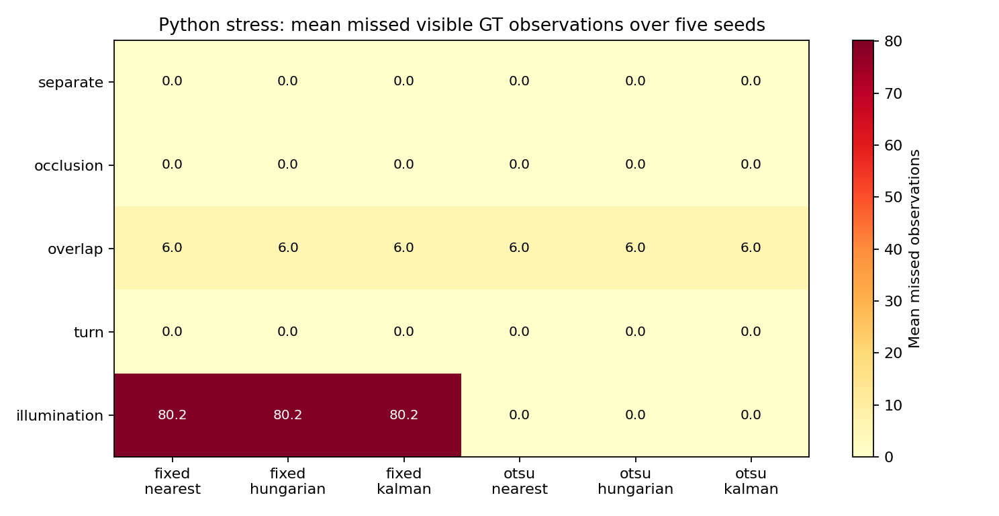
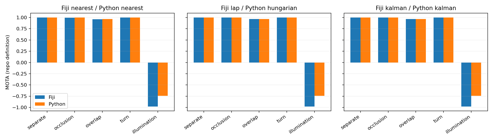
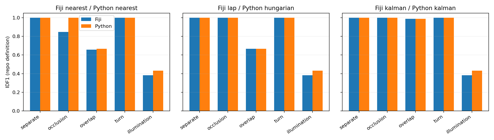
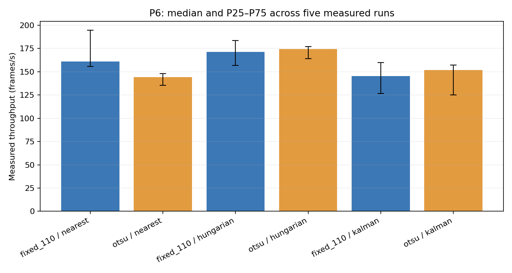

# Final experimental report — image detection and object tracking

## 1. Objective and scope

The experiment implements the lecturer's requested sequence: detect bright regions, segment them, calculate centroids, associate centroids with Nearest Neighbor or Hungarian, and display persistent track IDs and trajectories. A constant-velocity Kalman tracker is an advanced extension. Fiji TrackMate supplies an independent implementation for stress comparisons. All quantitative accuracy claims in this report use synthetic ground truth. The real video is an output demonstration without ground truth.

This handoff covers 5 stress scenarios × 5 noise seeds × 2 Python detector choices × 3 trackers = 150 stored Python configurations; 15 Fiji tracker results on seed0; 30 runtime measurements; and 6 real-video tracking outputs. No experiment was rerun for this report.

| Evidence | Source | Rows/files audited |
|---|---|---|
| Synthetic Python | ../stress_full/per_run.csv; ../stress_full/environment.json | 150 |
| Fiji and Python seed0 scoring | ../f4/comparison.csv; ../f4/validation.json | 15 |
| Fiji raw outputs | ../fiji_stress/{scenario}_seed0/ | 15 CSV + 15 XML |
| Runtime measurements | ../timing/runtime_per_run.csv | 30 |
| Real video output | ../real_video_tracking/tracking_summary.csv | 6 |
| Pipeline figures | ../pipeline_demo/manifest.json | 6 |

## 2. Environment and reproducibility

The Python stress environment records Python 3.12.10, NumPy 2.4.3, SciPy 1.17.1, Pillow 12.1.1, Windows-11-10.0.26200-SP0, CPU `Intel64 Family 6 Model 154 Stepping 3, GenuineIntel`, and 16 logical CPUs. The benchmark metadata records FFmpeg `ffmpeg version 9.0.2-full_build-www.gyan.dev`. Fiji's installed portable distribution records ImageJ 1.54p, TrackMate 8.1.6, and `openjdk version "21.0.7" 2025-04-15 LTS`. The common recorded base commit is `fed20818b9ff1688db89e25e8c882b0d74f00c83`. See [stress environment](../stress_full/environment.json), [privacy-safe Fiji metadata](metadata/fiji_run_metadata.json), and [privacy-safe P6 metadata](data/runtime_summary.csv) for exact executable paths, source hashes, and hardware settings.

Python stress uses a 24 px tracker gate, 5 allowed missed frames, SciPy assignment, area bounds 35–240 px, and an 8 px evaluation gate. Fiji uses threshold 110, linking distance 24 px, Simple LAP gap distance 36 px and max frame gap 6; its Kalman search radius is 24 px. These settings are recorded in the source XML and metadata. The portable Fiji folder does not expose one unique Fiji release number; the ImageJ and TrackMate component versions are reported instead.

## 3. Datasets and ground truth

Synthetic P3 contains 5 scenarios: `separate`, `occlusion`, `overlap`, `turn`, and `illumination`. Each sequence contains 80 frames of 320×180 grayscale images and three moving disks. The 5 seeds change image noise while following the same motion trajectories. The seed0 PNGs used by Fiji are the original 400 manifest-verified images; no images were regenerated for this report. GT rows carry `frame,object_id,x,y,visible`. In occlusion, invisible GT observations are excluded from visible-object matching. See [P3 manifest](../stress_manifest.csv) and [synthetic source](../../../experiments.py).

P4 supplies a 150-frame, 320×180 grayscale FFV1 video at 15/1 FPS. This real scene has **no manual GT**. The F2 annotation work remains paused. Its tracker outputs therefore cannot support MOTA, IDF1, FN, FP, ID-switch or positional accuracy claims.

## 4. Implemented pipeline

1. **Input:** `tracking.video_frames` decodes real video as grayscale; P3 PNGs already have mode `L`.
2. **Detection/segmentation:** `tracking.detect` applies `pixel > threshold` (fixed 110 or per-frame `tracking.otsu_threshold`), 3×3 binary opening by default, 8-connected component labeling, then inclusive area filtering 35–240 px. The returned binary mask is post-opening; centroids come only from accepted components.
3. **Centroid:** `scipy.ndimage.center_of_mass` computes each accepted component's center. `tracking.detect` returns `(x,y)` pixel coordinates.
4. **Association:** `Tracker.update` calls `associate` with Euclidean track-to-spot distances and a 24 px gate. Unmatched detections create new IDs; tracks expire after the configured missing-frame allowance.
5. **Trajectory:** `Track.points` stores observed positions, and `tracking.overlay` draws recent segments and IDs. The Kalman branch predicts a position/velocity state before association and updates it after an observation. Predicted state rows during misses are not emitted as observed detections.

The [Public pipeline map](pipeline_map.md) maps every visual step to the functions above. In this report, [Figure D1-1](figures/d1_01_detection_steps.png) shows source → threshold → opening → components → centroid; [Figure D1-2](figures/d1_02_association_nearest_hungarian.png) shows verified Nearest/Hungarian ID links and trajectories. The source PNG is already grayscale, so there is no separate grayscale conversion step in that example.

## 5. Association methods

| Method | Implemented decision | Practical behavior in these tests |
|---|---|---|
| Python Nearest | Greedily accepts the shortest remaining pair within gate | Simple and local; a crossing or missed observation can fragment/redirect an ID. |
| Python Hungarian | Globally maximizes valid pair count, then minimizes total gated distance with unmatched dummy assignments; the stress run uses SciPy's solver | Handles competing pairs jointly, but still depends on detector quality and its online active-track set. |
| Python Kalman | Constant-velocity prediction, then gated association and measurement update | Maintains a predicted state across short gaps; model assumptions can be wrong during turns or complex motion. |
| Fiji Simple LAP | TrackMate's own linking and gap-closing workflow | Compared to Python Hungarian for context, but is a different algorithm with different gap and cost behavior. |

No method is declared universally best from one scene or from throughput alone. Fiji and Python do not consume an identical imported detection list in this experiment, so their tracker differences also include detector differences.

## 6. Python synthetic stress: five seeds

The table below gives fixed-threshold means across all 5 stored seeds for each scenario/tracker. Counts are per 80-frame sequence and are averaged, not pooled observations. The [complete 30-row table](summary_tables/synthetic_5seed.md) also includes Otsu, mean track IDs and matched-pair RMSE; the [150-row source CSV](../stress_full/per_run.csv) retains every individual configuration. Its [aggregate CSV](../stress_full/aggregate.csv) was independently reconciled to per-run means and sample standard deviations.

| Scenario | Method | Mean matched | Mean missed | Mean FP | Mean switches |
|---|---|---|---|---|---|
| separate | nearest | 240.00 | 0.00 | 0.00 | 0.00 |
| separate | hungarian | 240.00 | 0.00 | 0.00 | 0.00 |
| separate | kalman | 240.00 | 0.00 | 0.00 | 0.00 |
| occlusion | nearest | 236.00 | 0.00 | 0.00 | 0.00 |
| occlusion | hungarian | 236.00 | 0.00 | 0.00 | 0.00 |
| occlusion | kalman | 236.00 | 0.00 | 0.00 | 0.00 |
| overlap | nearest | 234.00 | 6.00 | 0.00 | 2.00 |
| overlap | hungarian | 234.00 | 6.00 | 0.00 | 2.00 |
| overlap | kalman | 234.00 | 6.00 | 0.00 | 2.00 |
| turn | nearest | 240.00 | 0.00 | 0.00 | 0.00 |
| turn | hungarian | 240.00 | 0.00 | 0.00 | 0.00 |
| turn | kalman | 240.00 | 0.00 | 0.00 | 0.00 |
| illumination | nearest | 159.80 | 80.20 | 344.00 | 0.20 |
| illumination | hungarian | 159.80 | 80.20 | 344.00 | 0.20 |
| illumination | kalman | 159.80 | 80.20 | 344.00 | 0.20 |

This synthetic design isolates noise changes at fixed trajectories and appearance parameters. It is not a random sample of five independent motion problems. A low matched-pair RMSE is conditional on matches and must be read with missed and false-positive counts.

*Figure P7-1. Mean missed visible GT observations per scenario and Python configuration, derived from the 150-row stress CSV. Cell numbers are five-seed means.*

## 7. Fiji TrackMate and same-condition Python comparison

TrackMate 8.1.6 produced 15 CSV and 15 XML artifacts for the five seed0 sequences, using fixed threshold 110. F4 scored each Fiji CSV and the corresponding Python **seed0 fixed-threshold** CSV against the same synthetic GT with evaluation gate 8.0 px over all 80 input frames. Python Otsu is deliberately absent from this same-condition table. The full [F4 table](summary_tables/fiji_python_seed0.md) includes track-ID counts and matched-pair RMSE; this compact table retains all 15 method pairs and key error counts.

| Scenario | Fiji / Python | Fiji matched/missed/FP/switch | Python matched/missed/FP/switch | Fiji MOTA / IDF1 | Python MOTA / IDF1 |
|---|---|---|---|---|---|
| separate | nearest / nearest | 240/0/0/0 | 240/0/0/0 | 1.0 / 1.0 | 1.0 / 1.0 |
| separate | lap / hungarian | 240/0/0/0 | 240/0/0/0 | 1.0 / 1.0 | 1.0 / 1.0 |
| separate | kalman / kalman | 240/0/0/0 | 240/0/0/0 | 1.0 / 1.0 | 1.0 / 1.0 |
| occlusion | nearest / nearest | 236/0/0/1 | 236/0/0/0 | 0.9958 / 0.8475 | 1.0 / 1.0 |
| occlusion | lap / hungarian | 236/0/0/0 | 236/0/0/0 | 1.0 / 1.0 | 1.0 / 1.0 |
| occlusion | kalman / kalman | 236/0/0/0 | 236/0/0/0 | 1.0 / 1.0 | 1.0 / 1.0 |
| overlap | nearest / nearest | 234/6/0/3 | 234/6/0/2 | 0.9625 / 0.6582 | 0.9667 / 0.6667 |
| overlap | lap / hungarian | 234/6/0/2 | 234/6/0/2 | 0.9667 / 0.6667 | 0.9667 / 0.6667 |
| overlap | kalman / kalman | 234/6/0/2 | 234/6/0/2 | 0.9667 / 0.9873 | 0.9667 / 0.9873 |
| turn | nearest / nearest | 240/0/0/0 | 240/0/0/0 | 1.0 / 1.0 | 1.0 / 1.0 |
| turn | lap / hungarian | 240/0/0/0 | 240/0/0/0 | 1.0 / 1.0 | 1.0 / 1.0 |
| turn | kalman / kalman | 240/0/0/0 | 240/0/0/0 | 1.0 / 1.0 | 1.0 / 1.0 |
| illumination | nearest / nearest | 147/93/382/0 | 160/80/337/1 | -0.9792 / 0.3823 | -0.7417 / 0.4315 |
| illumination | lap / hungarian | 147/93/382/0 | 160/80/337/1 | -0.9792 / 0.3823 | -0.7417 / 0.4315 |
| illumination | kalman / kalman | 147/93/382/0 | 160/80/337/1 | -0.9792 / 0.3823 | -0.7417 / 0.4315 |

Metrics follow the repository's `evaluation.score_with_identity`, not a claim of MOTChallenge standard compliance. `matched` counts one-to-one visible-GT matches within the gate. `missed` and `false_positive` count unmatched visible GT and unmatched predictions. `id_switches` compares the ID last matched to each GT object, including across gaps. `MOTA = 1 − (missed + FP + ID switches) / visible GT observations`. The repository's IDF1 uses its global GT-to-track pairing. RMSE is the root mean squared positional error **only among matched pairs**; it is N/A when no pairs exist. All definitions and exact code are in [evaluation.py](../../../evaluation.py).

The [detector agreement table](summary_tables/detector_agreement.md) compares Fiji visible XML spot centers and Python fixed-threshold detector centers at its separately recorded agreement gate. Agreement is not accuracy against GT. It cannot by itself establish which tracking algorithm is better.

*Figure F4-1. Repository MOTA definition for the 15 seed0, fixed-threshold Fiji/Python pairs; values come from `../f4/comparison.csv`. Simple LAP and Hungarian are contextual counterparts, not the same algorithm.*

*Figure F4-2. Repository IDF1 definition for the same 15 pairs; a high location match count can coexist with identity fragmentation.*

## 8. P6 runtime benchmark

All 30 measured runs used the same 150-frame real FFV1 input, with one warm-up and 5 measured samples per detector/tracker configuration. Timing uses `perf_counter` for **FFmpeg decode + detection + tracker update**, excluding overlay rendering/encoding. Throughput is measured frames divided by wall-clock seconds, not the input file's nominal 15/1 frame rate. The summary percentiles below were recomputed from [individual public runs](data/runtime_per_run.csv).

| Detector | Tracker | Measured runs | P25 s | Median s | P75 s | P25 fps | Median fps | P75 fps |
|---|---|---|---|---|---|---|---|---|
| fixed_110 | nearest | 5 | 0.771 | 0.933 | 0.965 | 155.39 | 160.86 | 194.45 |
| otsu | nearest | 5 | 1.014 | 1.040 | 1.109 | 135.24 | 144.23 | 147.92 |
| fixed_110 | hungarian | 5 | 0.817 | 0.876 | 0.956 | 156.85 | 171.14 | 183.63 |
| otsu | hungarian | 5 | 0.848 | 0.860 | 0.915 | 163.98 | 174.46 | 176.88 |
| fixed_110 | kalman | 5 | 0.939 | 1.031 | 1.185 | 126.57 | 145.45 | 159.76 |
| otsu | kalman | 5 | 0.954 | 0.988 | 1.201 | 124.93 | 151.78 | 157.23 |

*Figure P6-1. Median measured throughput with P25–P75 error bars, read from `data/runtime_summary.csv`. It measures the specified pipeline stages on the recorded Windows CPU; it is not full overlay output FPS.*

Association-only timings in [stress solver timing](../stress_full/solver_timing.csv) exclude decode and detection and must not be substituted for these throughput values. FPS alone cannot rank tracking accuracy.

## 9. Real-video demonstration without GT

P5 revised generated 6 overlay videos and associated CSVs on the same 150-frame real input. The table reports only direct output counts from [tracking_summary.csv](../real_video_tracking/tracking_summary.csv). Distinct track IDs are **generated IDs**, not verified physical object counts or ID-switch errors.

| Configuration | Frames | Detection rows | Detections/frame mean | Track rows | Distinct output IDs | Max active IDs | Overlay frames |
|---|---|---|---|---|---|---|---|
| fixed_110_nearest | 150 | 2054 | 13.69 | 2054 | 524 | 62 | 150 |
| fixed_110_hungarian | 150 | 2054 | 13.69 | 2054 | 481 | 60 | 150 |
| fixed_110_kalman | 150 | 2054 | 13.69 | 2054 | 563 | 62 | 150 |
| otsu_nearest | 150 | 2548 | 16.99 | 2548 | 557 | 73 | 150 |
| otsu_hungarian | 150 | 2548 | 16.99 | 2548 | 498 | 67 | 150 |
| otsu_kalman | 150 | 2548 | 16.99 | 2548 | 637 | 74 | 150 |

*The P5 overlay and sampled frames are withheld from this public package. The table above is retained as recorded CSV output statistics; the source video is not included, so those real-video outputs cannot be rerun or visually rechecked from this package.*

## 10. Failure analysis

**Occlusion.** The synthetic GT marks one object invisible on the affected frames, so it does not add visible-GT misses there. F4 shows Fiji nearest 1 ID switch versus Python nearest 0 on seed0, while both have 236 visible matches. [Figure D1-4](figures/d1_04_occlusion_kalman_prediction.png) shows stored Kalman state prediction during the hidden interval; these are predicted states, not detections. A good short-gap prediction here does not prove robustness under other occlusions.

**Overlap.** The two nearby GT disks merge in the image. At the demonstrated frame, the post-opening merged component has area 269 px, above the configured 240 px limit, and the saved evaluator detail has only the third GT–track match. F4 nearest reports 6 Fiji misses and 6 Python misses for seed0; Fiji nearest has 3 switches and Python nearest 2. [Figure D1-3](figures/d1_03_overlap_verified_misses.png) shows this verified failure.

**Illumination.** The fixed threshold fails at both ends of the brightness sweep. F4 Fiji nearest has 147 matched, 93 missed and 382 false positives; its MOTA is -0.9792. Python nearest has 160 matched, 80 missed and 337 false positives; its MOTA is -0.7417. MOTA becomes negative because missed + FP + ID switches exceeds the visible-GT denominator. The original Fiji CSV contains observations only for frames 12–64 (53 frames); frames 0–11 and 65–79 have no observations (27 frames total). GT still covers all 80 frames. Missing prediction frames therefore contribute misses; they were not dropped from evaluation. Across the five Python noise seeds, fixed nearest averages 80.20 misses and 344.00 FP versus Otsu nearest 0.00 misses and 0.00 FP. This supports a detector-specific observation on this synthetic illumination design, not a universal Otsu ranking. [Figure D1-5](figures/d1_05_illumination_threshold_comparison.png) shows fixed and per-frame Otsu masks.

## 11. Limits and conclusion

- The synthetic disks, fixed trajectories, image noise, and five noise seeds are narrower than the dense, irregular real scene. Real-video identity and accuracy are unverified because GT was not completed.
- Fiji Simple LAP and Python Hungarian have different association/gap-closing rules. Fiji's threshold detector and Python's opening-based detector are also different, so observed discrepancies mix detector and tracker effects. A shared imported detection set would be required to isolate tracker behavior.
- The seed0 Fiji comparison cannot establish variation across the other four noise seeds. Hidden-state error and matched RMSE require their denominators/coverage; N/A is not zero.
- P6 samples one recorded machine and excludes overlay encode; elapsed time can vary with load. Association-only solver timing answers a different question.
- The pre-existing `separate_seed0` Fiji output lacked its original per-run log. Its CSV/XML content and configuration were validated read-only; no historical execution log was invented.

The evidence supports a functioning detection → centroid → association → trajectory pipeline and reproducible synthetic evaluation. Overlap and illumination are material failure modes under the fixed settings. The real-video segment demonstrates output generation only. A future manual GT set and a controlled shared-detection Fiji/Python test would allow stronger real-scene and tracker-specific conclusions.

## 12. Public figure and evidence handoff

This public report uses synthetic D1 figures and F4 results plus numeric P6 charts. The real source frame, P5 overlay samples, P4 media, and full local evidence manifest are withheld. The [public evidence manifest](public_evidence_manifest.json) records checksums for the exact public allowlist. The [public pipeline map](pipeline_map.md) maps the included visuals to code.

## Public package limits

The public package omits the internet-sourced real video, its 150 PNG frames, P4 manifest, real-video overlays/screenshots, and host-specific run locations. P5 scalar/CSV outputs and P6 timing measurements remain as recorded evidence, but they cannot be independently rerun or visually checked without the withheld source media. The P6 CSV copies preserve all numeric measurement columns and source SHA256; only the video path value is replaced with an omission marker. Synthetic GT, Fiji XML/CSV, and F4 scores remain available. The unchanged full P7 manifest is retained in the local workspace but excluded because it enumerates media absent from the public package.
